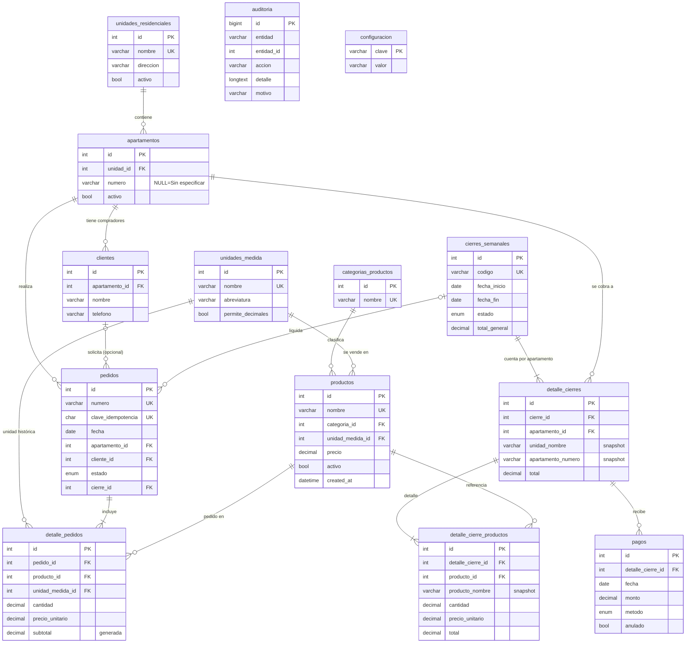

# Diagrama entidad-relación — FincaMarket

> Se visualiza en VS Code con la extensión "Markdown Preview Mermaid Support", o pegando el bloque en https://mermaid.live

**Vistas**: `v_pedidos_totales` (total e ítems por pedido) y `v_saldos_cierre` (total, pagado y saldo por cuenta de cobro).
